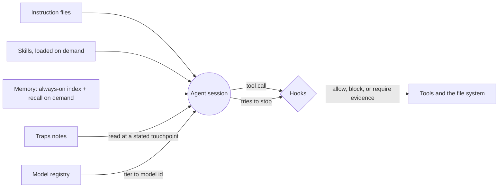

# How I work with coding agents

Written 2026-10-27. This describes a working setup that has grown over months of daily
use on a Windows machine with Claude Code as the main runtime and several other agent
CLIs alongside it. It is not a framework and it is not portable as-is. What is worth
reading is the reasoning: why each control exists, what failure it was added after, and
where it still does not hold.

The skills in this repository are the reusable part. This document is the context
around them.

## The problem

Coding agents are fluent and fast, and they are wrong in a particular way: they state
things about code and tooling with the same confidence whether or not they checked.
Review catches some of it, but the claims that do the most damage are the ones that
never reach a reviewed artefact. They are said in a chat message, believed, and acted on.

Everything below follows from taking that seriously. A rule written in an instruction
file is a request. The setup treats a request as insufficient and asks, for each rule
that matters, what mechanism makes breaking it fail visibly.

## The layers

| Layer | What it is | What it is for |
|---|---|---|
| Instruction files | One global file per agent runtime, plus a short file per repository | Conventions, routing policy, and the reasoning behind them |
| Hooks | Scripts the runtime calls before and after tool use, at session start, on each prompt, and when the agent tries to stop | The rules that must bind: they block, rewrite, or demand more evidence |
| Skills | Folders of task-specific instructions loaded on demand | Repeatable procedures: scaffolding, review, audit, handoff |
| Traps notes | Symptom, cause, fix catalogues, one per subsystem | What cost more than half an hour once and must not cost it twice |
| Memory | Two stores with a routing rule between them | Guidance that must be present every session, and project context retrieved on demand |
| Model registry | A table mapping capability tiers to whatever model ids exist today | Work is routed by tier, so nothing in the instructions names a model |

As of 2026-10-27 the live setup has 33 registered hook commands across 8 hook events
(session start, prompt submit, pre-tool, permission request, post-tool, pre-compact,
notification and stop), 103 authored skills in the canonical skills directory (24 are
published in this repository), and 17 traps notes. Those are counts read off the
directories that day, not targets.

## Principles, and the mechanism behind each

### 1. Observation before argument

If a claim is about how code or tooling behaves on this machine, and checking costs
under about two minutes, run the check rather than writing the argument. The tell is
whether the prose cost more than the command.

The rule exists because it was slipped. In one day there were five instances of
reasoning standing in for a cheaper check: a predicted collateral failure that took 40
seconds to disprove, a "no route exists" that was already in a test fixture, an "all
passed" read off a word rather than a count while a check that never ran hid a second
defect, and a cause named from one sample per arm when both arms resolved to the same
setting, which a five-second grep over an existing log refuted.

What binds it:

- A **stop hook** refuses to let the agent end a turn that asserts system behaviour with
  no evidence. A trigger phrase alone never blocks; it blocks only when the message
  carries no evidence marker at all (no fenced output, no stated run, no exit code, no
  admission). The agent then either runs the command or downgrades the claim.
- A second stop hook refuses a turn that cites a source it did not read in that turn,
  because a citation such as a file and line asserts a read, and line numbers move.
- Anything that genuinely cannot be observed is written with a literal `UNVERIFIED:`
  prefix and the condition that would refute it. The prefix is greppable and visibly
  ugly, and its absence is an assertion that an observation was made.
- A **pre-tool gate** on the traps notes refuses a substantial new entry that lacks a
  quoted observation and a `Refuted if:` line. Those notes are read by every agent on
  the machine and are not reviewed like code, so an unsupported entry in one reaches
  further than a wrong line in a pull request.

### 2. Route by tier, not by model name

Model ids change every few months and the capability tiers do not. Instructions name a
tier (frontier, workhorse, mechanical) and a small resolver turns it into whatever is
available. A model the registry has not triaged carries a null tier and is unroutable by
construction rather than by anyone remembering a policy.

Two rules inside the routing notes are not negotiable. Routing selects who does the
work and never changes how the work is checked, so no routing record is a reason to skip
a review. And an unknown or newly updated model enters through a contained slot with its
exit condition stated at entry, never straight into a role where nobody will check it.

### 3. Review across vendors, and keep two classes apart

A review panel made only of one vendor's models shares that vendor's blind spots, so its
second opinion mostly agrees with the first. The adversarial-review skill in this
repository puts one reviewer seat per vendor, makes them cross-examine each other, and
uses a separate judge. The active set must span a minimum number of vendors, and the
judge is never also a reviewer.

Review is split into two classes because they catch disjoint defects:

- **Commodity per-pull-request review** finds local implementation defects: stale
  assertions, disconnected tests, small mistakes.
- **The adversarial panel** finds cross-cutting design risk that spans subsystems, which
  a per-pull-request bot never frames. It runs as a scheduled sweep over merged code,
  one subsystem per pass, not as a gate on every change.

The per-pull-request reviewers are metered, so the setup spends them deliberately: one
push per branch at the end, fixes batched, and a reviewer that is rate-limited does not
hold a change that CI and the other reviewer have cleared. When a reviewer was skipped,
the record says so rather than calling the change reviewed.

### 4. Gates that hold the session, not just the merge

Opening a pull request is blocked until the agent has run the branch-finishing
procedure. After it opens, a hook classifies the change by risk tier from committed
path globs, names the reviewers that tier requires, and a stop hook then refuses to let
the session end until CI, those reviewers and every review thread are clean at the
current commit. The tier is never self-assigned by the agent. If a reviewer is silent
the hook says so, because a green check can be what a paused reviewer looks like.

### 5. Safety by default

Destructive and credential-hunting commands are blocked before they run. Before any
recursive delete, the resolved target has to be positively validated as owned by the
current task, and its path printed; a variable name or an intended assignment is not
evidence of ownership. Directories that a runtime reads directly (the live homes of the
configuration itself) have exactly one checkout and are changed through a worktree, so
nothing running on the machine reads a half-merged state. Backups are local and proved
to restore; an archived remote repository is not a backup.

### 6. Memory is two stores with a routing rule

One store loads its index in full every session and is capped, so every entry costs
context forever; it holds durable guidance, corrections and pointers. The other is
retrieved on demand with no ceiling; it holds per-project working context and decision
records. A fact goes in one, never both. The routing rule was written after measuring
the same facts duplicated in both stores, and after finding that nearly every entry in
the on-demand store had never been read back, which means a store that is only written
to is pure cost.

### 7. Handoffs are files, and a name is never reused

When work has to cross a session boundary, the brief is written to disk before the
context is lost. It lists what is done, the one concrete next action, dead ends with the
reason they were rejected, decisions already made, and only the instruction-file rules
the target is missing. The filename carries a random token and nothing is overwritten,
because several agents can work the same repository at once and a shared name lets one
destroy another's brief with no trace.

## What went wrong, and what changed

These are real, and each produced a mechanism rather than a resolution to be careful.

| What happened | What it taught |
|---|---|
| A cause was written into a shared notes file from one failing run per arm, on a fault already described as intermittent. Both arms had resolved to the same setting. | A note that reads as recording receives less scrutiny than any reviewed file while reaching every agent. The traps entry gate now refuses an unsupported entry. |
| Two sessions started from the same handoff brief and both ran the full pass against one branch. One session's uncommitted file was swept into the other's commit, then discarded. | Prove branch ownership before writing. A brief dispatched twice has two writers and no lock. |
| A bulk checkout was about to be run across a stale live home. Its own merged edits still read as uncommitted. | Classify per path against the upstream first. On the day, 16 entries were pending and 11 were leftovers; the blanket command would have destroyed the other 5. |
| A review check stayed green while the reviewer behind it was paused. | A check is not a verdict. The gate reads the reviewer's own comment and reports a coverage gap rather than a pass. |
| A tool upgrade appeared to fail only under coverage, which suggested a timing bug. | Read the log before believing the explanation. A plain assertion failure under coverage is contention; only one specific error signature means the tooling bug. |

## Limits

- **Single operator, single machine.** Paths, shells and the hook runner assume
  Windows with PowerShell. None of this has been tested as a team setup.
- **Some gates are heuristics.** The unobserved-claim hook works from trigger phrases
  and a deliberately permissive evidence test. It reduces the problem; it does not
  prove an answer was checked.
- **Maintenance is a cost.** Hooks have latency, rules interact, and each gate is one
  more thing to keep working. A gate that is inert looks exactly like a healthy one, so
  several of them carry self-tests and the setup records the rationale beside each hook.
- **The published skills are a sanitised subset.** They are ported one way from the
  private working copy and a public check fails the build on leaked paths, private
  names and real endpoints.
- **Model pins age.** Where this repository carries a literal model pin it needs
  updating, or a registry installed beside the skill.

## If you want to borrow from it

In order of payoff for effort:

1. Write the observation rule down, then add the stop hook that makes an unobserved
   claim fail to land. This is the single most valuable control here.
2. Put handoffs on disk with unique names.
3. Adopt `scaffold-ci` and `review-worktree-pass` for the pull request and review
   workflow, and `audit-skills` to keep a growing skill set from drifting.
4. Add cross-vendor review only once the cheaper controls are in place; it is the most
   expensive part and the part most dependent on having several vendors available.

The skills are indexed in the [README](../README.md); the conventions for contributing
to this repository are in [AGENTS.md](../AGENTS.md).
